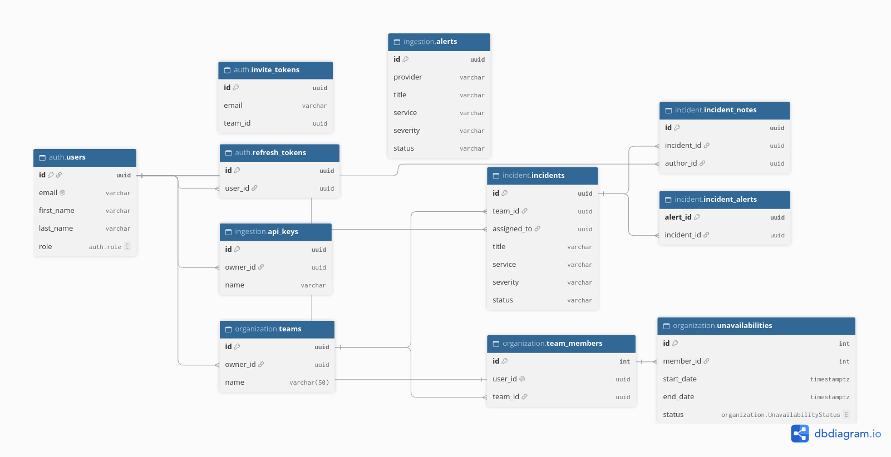

_This project has been created as part of the 42 curriculum by asebban, yahrour, aaitabde, sait-nac._

# Incident Lifecycle Manager

## Table of Contents

1. [Description](#description)
2. [Team Information](#team-information)
3. [Project Management](#project-management)
4. [Technical Stack](#technical-stack)
5. [Database Schema](#database-schema)
6. [Features List](#features-list)
7. [Modules](#modules)
8. [Individual Contributions](#individual-contributions)
9. [Instructions](#instructions)
10. [Resources](#resources)
11. [Known Limitations](#known-limitations)

## Description

**Incident Lifecycle Manager** is a self-hosted web application that tracks an incident from alert to resolution: an alert fires, becomes an incident, reaches the engineer actually on call, and every step is recorded and measured.

### Goal

On-call work fails in predictable ways: alerts go unseen, duplicate alerts get handled twice, the paged person is unavailable, and nobody can say how long an outage lasted or how fast the team responded.

This project closes those gaps in one system. It ingests alerts from monitoring tools, merges repeats into a single incident, routes it to the current on-call engineer, escalates when nobody acknowledges, and turns the timeline into response metrics (MTTA and MTTR).

### Key features

- **Alert ingestion.** Monitoring tools post alerts with an API key, and every ingested alert stays visible in a delivery log.
- **Duplicate suppression.** Repeat alerts for the same problem join the existing incident instead of creating a new one.
- **Incident lifecycle.** Search, filters and pagination, a detail view with a timeline, notes, reassignment, acknowledge and resolve.
- **Response metrics.** MTTA and MTTR computed from the incident's own timestamps.
- **Live updates.** Incident changes reach every connected client without a refresh.
- **On-call rotation.** Per-team rotations that skip approved leave, with automatic assignment and escalation.
- **Teams and access.** Team and member management, unavailability requests, and `SRE` / `ENGINEER` roles.
- **Operational tooling.** WAF, secrets in Vault, Prometheus and Grafana, health and status page, scheduled backups.

## Team Information

- **asebban** ([TODO — unassigned]):
  - [TODO — brief description of responsibilities]

- **yahrour** (Technical Lead / Architect, Developer):
  - Owns technical direction: architecture, stack decisions and code quality conventions
  - Reviews critical changes and maintains the repository workflow (branch rules, commit and lint standards)
  - Implements features alongside the rest of the team

- **aaitabde** ([TODO — unassigned]):
  - [TODO — brief description of responsibilities]

- **sait-nac** ([TODO — unassigned]):
  - [TODO — brief description of responsibilities]

---

## Project Management

- **Work organization (task distribution, meetings):** [TODO — owner: unassigned — how tasks were split, meeting frequency, review process]
- **Task tracking:** GitHub, with pull requests. [TODO — owner: unassigned — add Issues/Projects/board usage if any]
- **Communication channel:** Discord.

---

## Technical Stack

| Layer          | Technology                                                                                                                                                                                                                                                                                                                                                                                                                                                                                                                                                                                                                                                                                                                                                                                                                                                                               |
| -------------- | ---------------------------------------------------------------------------------------------------------------------------------------------------------------------------------------------------------------------------------------------------------------------------------------------------------------------------------------------------------------------------------------------------------------------------------------------------------------------------------------------------------------------------------------------------------------------------------------------------------------------------------------------------------------------------------------------------------------------------------------------------------------------------------------------------------------------------------------------------------------------------------------- |
| Frontend       |         |
| Backend        |                                                                                                                                |
| Database       |                                                                                                                                                                                                                                                                                                                                                                                                                                                                                                                                                                                                                                                          |
| Infrastructure |                                                                                                                       |
| Tooling        |                                                                                                                                                                                                                                                                                                                                                                                                                                                                                                                  |

**We chose this stack because it gave us production-grade structure without slowing the team down: NestJS supplies guards, validation, scheduling and metrics as built-in modules, React with TanStack Query handles a data-dense interface, and PostgreSQL enforces the uniqueness rules the incident engine depends on.**

### Database

**PostgreSQL 18** split across four schemas that mirror the module boundaries: `auth`, `organization`, `incident` and `ingestion`.

| Need                                        | How PostgreSQL provides it                                                                                                         |
| ------------------------------------------- | ---------------------------------------------------------------------------------------------------------------------------------- |
| Timezone-aware timestamps for MTTA and MTTR | Native `timestamptz` stored as UTC, so subtracting `acknowledged_at` or `resolved_at` from `created_at` is correct in any timezone |
| A team's services as one column             | Native `text[]`, filterable directly instead of a join table                                                                       |
| Arbitrary provider payloads                 | `jsonb`, which stays queryable                                                                                                     |
| Four separated domains in one database      | Native schemas, so `auth`, `organization`, `incident` and `ingestion` stay isolated without extra database servers                 |

## Database Schema

[](./docs/db-diagram.png)

> **Note:** This diagram is a simplified overview. Audit columns, defaults, and indexes are omitted. For the detailed database visualization with all columns and constraints, visit the interactive diagram below.

The diagram was generated with [dbdiagram.io](https://dbdiagram.io). You can view it [here](https://dbdiagram.io/d/6af3602b04c7e97b1d24f9ec).

## Features List

| Feature                             | Description                                                               | Contributor(s)    |
| ----------------------------------- | ------------------------------------------------------------------------- | ----------------- |
| Authentication                      | Email/password sign-up and sign-in, token refresh, logout                 | sait-nac          |
| Google sign-in                      | OAuth 2.0 login with Google                                               | sait-nac          |
| Invitations                         | Invite users to a team by token and accept the invite                     | sait-nac          |
| Incident management                 | List with search and filters, detail, notes, assign, acknowledge, resolve | aaitabde          |
| Live incident events                | Server-sent event stream on incidents                                     | aaitabde          |
| Alert ingestion                     | Providers post alerts using API keys; API key management                  | asebban           |
| Teams and members                   | Create, edit, delete teams; view and remove members; team stats           | yahrour           |
| On-call and unavailability          | Current/upcoming on-call, unavailability requests with approve/reject     | yahrour           |
| Team export / import                | Export and import team data                                               | yahrour           |
| Overview dashboard                  | Incident and team metrics                                                 | yahrour, aaitabde |
| Health and status page              | Health endpoint and status page                                           | yahrour           |
| Privacy Policy and Terms of Service | Pages in the frontend landing feature                                     | asebban           |
| Metrics and monitoring              | Prometheus metrics, Grafana dashboards and alert rules                    | sait-nac          |
| Backups                             | Scheduled database backups and a restore procedure                        | yahrour           |

## Modules

### Web

#### Major: Use a framework for both the frontend and backend

- **Team member(s) that worked on this module:** `yahrour`, `asebban`, `aaitabde`, `sait-nac`
- **Module choice:** Both sides need routing, validation, guards and scheduling that we would otherwise hand-roll. We would have used frameworks regardless of the module.
- **Module implementation:** NestJS 11 for the API, React 19 with Vite for the frontend, both in TypeScript, with React Router and TanStack Query.

#### Major: Implement real-time features using WebSockets or similar technology

- **Team member(s) that worked on this module:** `aaitabde`
- **Module choice:** A dashboard that only updates on refresh is misleading during an outage. Updates travel server to client only, so SSE fits without a duplex protocol.
- **Module implementation:** `@Sse("events")` streams filtered incident changes from an RxJS observable; `useIncidentEvents` opens an `EventSource`, reconnects on close and invalidates the query cache.

#### Minor: Use an ORM for the database

- **Team member(s) that worked on this module:** `yahrour`, `asebban`, `aaitabde`, `sait-nac`
- **Module choice:** Hand-written SQL across eleven tables means hand-maintained types and broken queries after every schema change.
- **Module implementation:** Prisma 7.9 with the `@prisma/adapter-pg` driver adapter, models split per bounded context and an initial migration versioned.

#### Minor: Custom-made design system with reusable components

- **Team member(s) that worked on this module:** `yahrour`, `asebban`, `aaitabde`, `sait-nac`
- **Module choice:** Four people building screens independently produce four different buttons.
- **Module implementation:** 30 reusable components in `frontend/src/components/ui/`, a CSS custom property palette with light and dark values, Roboto and Public Sans type scale, and lucide-react icons.

#### Minor: Advanced search functionality with filters, sorting and pagination

- **Team member(s) that worked on this module:** `aaitabde`, `yahrour`
- **Module choice:** Incident lists grow without bound, and an on-call engineer cannot find what they need during an outage without server-side filtering.
- **Module implementation:** A validated `FindIncidentsDto` with cursor pagination for incidents, offset pagination with sortable columns for teams, members and unavailabilities, and filter state in URL search params.

---

### User Management

#### Major: Advanced permissions system

- **Team member(s) that worked on this module:** `sait-nac`
- **Module choice:** An `ENGINEER` acts on their own team's incidents; an `SRE` has broader reach. One enforcement point beats a check in every controller.
- **Module implementation:** A `@Roles(...)` decorator read by `RolesGuard` via `Reflector`, returning `403` or `401`, plus ownership checks in the services (`accessibleBy`, assignee verification).

#### Major: An organization system

- **Team member(s) that worked on this module:** `yahrour`
- **Module choice:** Incidents belong to teams that rotate responsibility, not to individuals. This layer decides who an incident reaches.
- **Module implementation:** `teams`, `team_members` and `unavailabilities` with rotation period, index and escalation timeout, split into `teams`, `members` and `unavailability` services. Unavailability requests are approved or rejected by the owner with overlap and expiry validation. The on-call chain built on top of this data is claimed separately as a module of choice.

#### Minor: Implement remote authentication with OAuth 2.0

- **Team member(s) that worked on this module:** `sait-nac`
- **Module choice:** Requiring a new password for a tool people check during an outage is friction that costs response time.
- **Module implementation:** `passport-google-oauth20` with `@nestjs/passport`; an optional unique `googleId` beside a nullable `passwordHash`, issuing the same JWT and refresh cookie as the password path.

---

### Cybersecurity

#### Major: Implement WAF/ModSecurity (hardened) + HashiCorp Vault for secrets

- **Team member(s) that worked on this module:** `asebban`
- **Module choice:** The API is internet-facing and accepts arbitrary JSON from monitoring providers. Passwords and JWT secrets must not sit in the repository or the Compose file.
- **Module implementation:** `owasp/modsecurity-crs:nginx` with `SecRuleEngine On`, TLS on 443 and `/api/v1/` proxied to the backend. Vault runs as its own service with a `tmpfs` secret volume and a scoped backend token.

---

### Devops

#### Major: Monitoring system with Prometheus and Grafana

- **Team member(s) that worked on this module:** `sait-nac`
- **Module choice:** The application cannot report on request latency, error rates or database pressure by itself, and an incident tool with no observability of its own would be a poor look.
- **Module implementation:** `@willsoto/nestjs-prometheus` with an HTTP duration histogram at `/api/metrics`; Prometheus scrapes the backend and `postgres-exporter`, and Grafana is provisioned as code with two dashboards and alert rules.

#### Minor: Health check and status page system with automated backups and disaster recovery procedures

- **Team member(s) that worked on this module:** `yahrour`, `asebban`
- **Module choice:** An incident tool that goes down silently is worse than useless.
- **Module implementation:** `@nestjs/terminus` behind `GET /health`, polled by the status page every 30 seconds; a Compose service runs `pg_dump` on a schedule, with `db.restore.sh` and a documented recovery runbook.

#### How the Devops work was split across the team

| Team member | Devops work                                                                            |
| ----------- | -------------------------------------------------------------------------------------- |
| `yahrour`   | PostgreSQL backup and restore service, plus the recovery runbook                       |
| `sait-nac`  | Prometheus, Grafana dashboards and alert rules, `postgres-exporter`                    |
| `asebban`   | Vault and WAF containers, including their Dockerfiles and the nginx/ModSecurity config |
| `aaitabde`  | A database migration service in Compose                                                |

---

### Data and Analytics

#### Minor: Data export and import functionality

- **Team member(s) that worked on this module:** `yahrour`
- **Module choice:** Team configuration is tedious to enter by hand, and teams want their data out rather than locked in.
- **Module implementation:** `GET /teams/export` and `POST /teams/import`, serialising to JSON or CSV with `csv-stringify` and parsing uploads with `csv-parse` behind a `FileExtensionValidator` pipe.

---

### Accessibility and Internationalization

#### Minor: Support for additional browsers

- **Team member(s) that worked on this module:** `yahrour`, `asebban`, `aaitabde`, `sait-nac`
- **Module choice:** A tool used during an outage cannot assume the responder has a choice of browser. Firefox and Edge and Brave are realistic alternatives on a work machine, so we support them alongside Chrome.
- **Module implementation:** We wrote the app with standard web features that Chrome, Firefox and Edge all support, and used no browser-specific code.

---

### Modules of choice

#### Minor: On-call scheduling

- **Team member that worked on this module:** `yahrour`
- **Module choice:** An incident platform is only as good as its routing. An alert that reaches nobody, or reaches someone on holiday, is worse than no alert at all. Rotations kept by hand in a spreadsheet drift out of date and ignore absences. No listed module covers this, and it is the link between the organization system (who belongs to a team) and the incident lifecycle (who gets paged), so we built it as its own module.
- **What technical challenges it addresses:**
  - **Rotations that do not drift.** `processRotations` advances each team on its own `rotationPeriodDays` from a `rotationStartDate`, and computes the next boundary from the scheduled time rather than from when the job happened to run. Shifts stay on schedule even if the cron is late or the service restarts.
  - **Safe with several instances.** The rotation write is a conditional `updateMany` that only applies if `lastRotatedAt` and `currentRotationIndex` still match what was read. If several instances run the same cron, a team still advances exactly once per period.
  - **Absence-aware coverage.** `getTeamCurrentOnCall` skips members whose approved unavailability is active now and builds a two-level chain, PRIMARY then SECONDARY. A single available member fills both roles; if nobody is available the chain is empty rather than naming someone who is away.
  - **Forecasting.** `getUpcomingRotations` projects the next shifts and checks each against future approved absences, so it shows who will actually cover a slot, not only who is scheduled.
  - **Privacy by role.** Owners see full details in the forecast; teammates see only public fields, with no id, email or role.
- **How it adds value:** On-call is what makes an incident land on a real person. The PRIMARY/SECONDARY chain decides who a new incident is assigned to, and supplies the escalation job (`escalateUnacknowledged`) with its next responder when an incident is not acknowledged within `escalationTimeoutMinutes`. Engineers see their current shift, when it ends, and their open incidents; owners see who covers now and next. Approved leave is respected automatically, so nobody is paged on holiday.
- **Why it deserves Minor status:** It is one small, self-contained piece rather than a whole feature area. Most of it only reads data the organization module already stores, so what makes it hard is getting the timing right, not the amount of code.
- **Module implementation:** The logic lives in one service, `backend/src/modules/on-call/on-call.service.ts`, and it reads from two places. Each team stores its own schedule settings: how long a shift lasts, when the rotation started, who is currently up, when the last handover happened, and how long an incident may go unacknowledged before it escalates. Approved absences come from the `unavailabilities` table. Two read endpoints expose the result, one for who is on call right now and one for the upcoming shifts, and a scheduled job runs every minute to move any team whose shift has ended on to the next person.

---

### Points

| Category                               | Modules                       |   Points   |
| -------------------------------------- | ----------------------------- | :--------: |
| Web                                    | 2 Majors and 3 Minors         |   7 pts    |
| Accessibility and Internationalization | 1 Minor                       |    1 pt    |
| User Management                        | 2 Majors and 1 Minor          |   5 pts    |
| Cybersecurity                          | 1 Major                       |   2 pts    |
| Devops                                 | 1 Major and 1 Minor           |   3 pts    |
| Data and Analytics                     | 1 Minor                       |    1 pt    |
| Modules of choice                      | 1 Minor                       |    1 pt    |
| **Total**                              | **6 Major(s) and 8 Minor(s)** | **20 pts** |

The subject requires a minimum of 14 points; this selection totals **20**.

## Individual Contributions

### asebban

- **Contributions:** [TODO]
- **Challenges and solutions:** [TODO]

### yahrour

**Roles:** Technical Lead / Architect, Developer

#### Contributions

**Architecture.** Started the backend as a microservices skeleton, then led the migration to a modular monolith once it became clear the domain did not justify the operational cost of separate services. Reorganised the Prisma schema into one file per bounded context and moved modules to match those boundaries, so the code structure and the database schemas describe the same four domains.

**Organization domain** (the largest single share of the codebase): team CRUD with services, rotation period and escalation timeout; team members with pagination, sorting and search; unavailability requests with approval, rejection, overlap detection and expiry handling; team export and import in JSON and CSV; and the team metrics that feed the overview dashboard. The on-call rotation engine built on this data is described under [Modules of choice](#modules-of-choice).

**Cross-cutting work.** The health endpoint and status page. The database backup and restore scripts with the disaster recovery documentation. Offset pagination and sortable columns across teams, members and unavailabilities. The frontend foundation: Vite and Tailwind setup, axios and TanStack Query, absolute imports, environment validation, the `Page` layout component and the colour theme.

#### Challenges and solutions

**On-call rotation drift.** The first rotation implementation advanced the index by comparing the last rotation time to the current time and then writing `now` as the new `lastRotatedAt`. Because the cron runs every minute, each rotation was recorded a little later than the moment it was actually due, and that error accumulated: after several cycles the handover drifted by hours, and eventually by a whole rotation period. The fix was to stop storing `now` and instead store the scheduled handover time, computed as `baseTime + rotationPeriodDays`, so the schedule stays anchored to its original start date no matter when the cron happens to run.

**Race conditions in unavailability review.** Approving or rejecting a request was a read-then-write: the service loaded the row, checked that its status was `PENDING`, and then wrote the new status. Between the check and the write, another request could change the row. The team owner double-clicking approve, or two browser tabs open on the same pending request, would both read `PENDING`, both pass the check, and both write, so the last write silently won and the first decision was lost with no error to the caller.

The fix was to stop trusting the earlier read and make the write itself conditional. The expected status moved into the `where` clause of an `updateMany`, so the database only updates the row if it is still `PENDING` at the moment of the write, and the returned `count` tells the caller whether it won. A `count` of `0` means someone else changed the row first, and the request is rejected instead of overwriting their decision.

### aaitabde

- **Contributions:** [TODO]
- **Challenges and solutions:** [TODO]

### sait-nac

- **Contributions:** [TODO]
- **Challenges and solutions:** [TODO]

## Instructions

### Prerequisites

Docker, Docker Compose.

### Configuration

The stack reads configuration from four `.env` files. Each has a committed `.env.example`; copy it and fill in the values. All four files are gitignored, so nothing secret is committed.

```bash
cp infra/vault/.env.example      infra/vault/.env
cp backend/.env.example          backend/.env
cp frontend/.env.example         frontend/.env
cp infra/.env.example            infra/.env
```

**`infra/vault/.env`** — the source of truth for secrets. Vault reads this on first boot and writes the values into its KV store. Required keys:

| Key                                                 | Purpose                                                                             |
| --------------------------------------------------- | ----------------------------------------------------------------------------------- |
| `POSTGRES_USER`, `POSTGRES_PASSWORD`, `POSTGRES_DB` | Database credentials, also rendered to files for the Postgres and backup containers |
| `GRAFANA_ADMIN_USER`, `GRAFANA_ADMIN_PASSWORD`      | Grafana admin account                                                               |
| `JWT_SECRET`, `JWT_REFRESH_SECRET`                  | Token signing secrets                                                               |
| `GOOGLE_CLIENT_ID`, `GOOGLE_CLIENT_SECRET`          | Google OAuth 2.0 credentials                                                        |

**`backend/.env`** — non-secret runtime configuration. The backend validates this file with a Joi schema at startup and refuses to boot if anything required is missing or malformed.

| Key                                   | Notes                                                   |
| ------------------------------------- | ------------------------------------------------------- |
| `TZ`                                  | Must be exactly `UTC`; the schema rejects anything else |
| `NODE_ENV`                            | `development` or `production`                           |
| `PORT`                                | Defaults to `3000`                                      |
| `JWT_AUDIENCE`, `JWT_ISSUER`          | Required strings                                        |
| `VAULT_ADDR`                          | `http://vault:8200` inside the Compose network          |
| `GOOGLE_CALLBACK_URL`, `FRONTEND_URL` | Full URLs; `FRONTEND_URL` is also the CORS origin       |
| `IMPORT_MAX_FILE_BYTES`               | Upload limit for team import, defaults to `1048576`     |

`DATABASE_URL`, `JWT_SECRET`, `JWT_REFRESH_SECRET`, `GOOGLE_CLIENT_ID` and `GOOGLE_CLIENT_SECRET` are **not** set in this file. The backend pulls them from Vault at startup and injects them into `process.env` before the application module is loaded.

**`frontend/.env`** — build-time variables, validated with Zod. Because Vite inlines `VITE_*` variables at build time, the image must be rebuilt after changing them.

| Key                          | Notes                                            |
| ---------------------------- | ------------------------------------------------ |
| `VITE_API_URL`               | Backend (API) base URL                           |
| `VITE_APP_NAME`              | Displayed in the UI; required, cannot be empty   |
| `VITE_IMPORT_MAX_FILE_BYTES` | Must match the backend's `IMPORT_MAX_FILE_BYTES` |

### Build and run

Deployment is a single command from the repository root:

```bash
docker compose up --build
```

First boot takes several minutes. The services start in dependency order and each waits on the one before it:

1. **Vault** initialises itself. On first boot it runs `vault operator init`, unseals, enables KV v2 at `secret/`, writes the Postgres and Grafana secrets plus the application secrets, creates a scoped `incident-backend` policy and a 24-hour token, then renders the secret files that other containers read. It signals readiness by creating `/vault/secrets/.ready`. The unseal key and root token are written to the `vault_token` volume at `/vault/runtime/init.json`.
2. **Postgres** starts once Vault is healthy, reading its credentials from the rendered secret files.
3. **Backend** starts once Postgres and Vault are healthy. It loads secrets from Vault, then applies the schema with `prisma db push`, then boots NestJS. Its healthcheck has a 300-second start period to allow for this.
4. **Frontend** starts once the backend is healthy.
5. **WAF** starts last, in front of both.

To run it detached, add `-d`:

```bash
docker compose up --build -d
```

To stop the stack, and to wipe the database and Vault state as well:

```bash
docker compose down          # stop, keep volumes
docker compose down -v       # stop and delete all volumes (database, Vault data, secrets)
```

### Access URLs

All traffic should go through the WAF on port 8443, which terminates TLS with a self-signed certificate. Your browser will warn about the certificate on first visit; that is expected.

| URL                               | Service                                |
| --------------------------------- | -------------------------------------- |
| `https://localhost:8443`          | The application, through the WAF       |
| `http://localhost:8080`           | Redirects to HTTPS on 8443             |
| `https://localhost:8443/api/v1/`  | API, proxied by the WAF to the backend |
| `https://localhost:8443/grafana/` | Grafana, proxied by the WAF            |

### Backups and restore

The `postgres-backup` service runs `pg_dump` every day via cron, writing timestamped `.sql` files into `./backups` on the host. Each dump is written to a `.tmp` file first and only renamed on success, so a failed dump never leaves a truncated backup in place.

The full procedure for restoring a database is in [`infra/database/DISASTER_RECOVERY.md`](infra/database/DISASTER_RECOVERY.md)

## Resources

### References

**Frameworks and libraries**

- [NestJS documentation](https://docs.nestjs.com) — modules, guards, interceptors, scheduling and SSE
- [React documentation](https://react.dev) — components, hooks and state
- [TanStack Query documentation](https://tanstack.com/query/latest/docs) — server-state caching and invalidation
- [Prisma documentation](https://www.prisma.io/docs) — schema, client, migrations and the `pg` driver adapter
- [Tailwind CSS documentation](https://tailwindcss.com/docs) — utility styling and the `@theme` configuration
- [React Router documentation](https://reactrouter.com) — routing and nested layouts
- [Zod documentation](https://zod.dev) — schema validation on the frontend

**Database**

- [PostgreSQL documentation](https://www.postgresql.org/docs/18/) — `timestamptz`, `text[]`, `jsonb`, schemas and unique indexes

**Infrastructure and security**

- [Docker Compose documentation](https://docs.docker.com/compose/) — service definitions, healthchecks and `depends_on`
- [ModSecurity reference manual](https://github.com/owasp-modsecurity/ModSecurity/wiki/Reference-Manual) — rule engine and configuration directives
- [OWASP Core Rule Set documentation](https://coreruleset.org/docs/) — the managed rule set behind the WAF
- [nginx documentation](https://nginx.org/en/docs/) — TLS termination and reverse proxying
- [HashiCorp Vault documentation](https://developer.hashicorp.com/vault/docs) — KV v2 secrets engine, policies and tokens
- [Prometheus documentation](https://prometheus.io/docs/) — scrape configuration and PromQL
- [Grafana documentation](https://grafana.com/docs/) — provisioning dashboards and alert rules
- [postgres_exporter](https://github.com/prometheus-community/postgres_exporter) — database metrics for Prometheus

**Tooling**

- [Conventional Commits](https://www.conventionalcommits.org/) — the commit format enforced by commitlint
- [commitlint](https://commitlint.js.org/) and [Husky](https://typicode.github.io/husky/) — commit hooks
- [dbdiagram.io](https://dbdiagram.io) — the database diagram in this README

### AI usage

AI tools were used as an assistant during development, not as a replacement for understanding. The practice was consistent across the team: AI was used to draft, explain and review, and every output was read, checked against the actual code, and rewritten or discarded where it was wrong. No feature was merged without a team member being able to explain how it works.

---

## Known Limitations

- [TODO]
